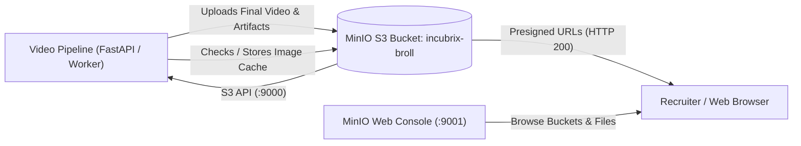

# 🐳 MinIO & Docker Object Storage Integration Guide

## 1. Overview

The Incubrix Context-Aware B-Roll Video Engine is integrated with **MinIO** and **Docker** for enterprise-grade, S3-compatible object storage.

All final artifacts, rendered videos, evaluation sheets, manifests, subtitles, and candidate images are automatically persisted to MinIO object storage. In addition, an image caching layer ensures that repeated asset searches and downloads are served directly from MinIO, accelerating generation speed and preventing API quota exhaustion.

---

## 2. Docker & MinIO Architecture



---

## 3. Quick Start

### A. Start MinIO with Docker Compose
From the repository root directory, run:

```bash
docker compose up -d minio
```

This starts the MinIO object storage service:
- **S3 API Endpoint**: `http://localhost:9000`
- **MinIO Web Console**: `http://localhost:9001`
- **Username / Access Key**: `minioadmin`
- **Password / Secret Key**: `minioadmin`
- **Default Bucket**: `incubrix-broll`

### B. Verify Object Storage
Run the automated verification script:

```bash
python backend/test_minio_integration.py
```

This tests:
1. MinIO client connection and bucket validation.
2. File upload and S3 URI generation (`s3://incubrix-broll/...`).
3. Presigned download URL generation.
4. Image caching and retrieval (`s3://incubrix-broll/cache/images/...`).
5. Enumeration of stored job artifacts.

---

## 4. Object Storage Layout

All assets in the `incubrix-broll` bucket are organized systematically:

```
incubrix-broll/
├── jobs/
│   └── {job_id}/
│       ├── output_16x9.mp4            # Final 1080p rendered video
│       ├── captions.srt               # Synchronized word-level subtitles
│       ├── evaluation_sheet.csv       # 30-column production evaluation sheet
│       ├── evaluation_sheet.json      # Structured evaluation data
│       ├── manifest.json              # Section 15 complete job manifest
│       ├── timeline.json              # Section 16 timeline data
│       ├── validation_report.json     # Technical audit report
│       ├── narration.wav / .mp3       # Narration audio track
│       └── candidate_frames/          # Downloaded & verified candidate imagery
│           ├── scene_001/
│           └── ...
└── cache/
    └── images/
        ├── {url_hash}.jpg             # Cached Pixabay stock images
        └── ...
```

---

## 5. Environment Variables & Configuration

In `.env` or Docker environment:

| Variable | Default | Purpose |
|---|---|---|
| `USE_MINIO` | `true` | Enable MinIO S3 object storage |
| `MINIO_ENDPOINT` | `localhost:9000` (`minio:9000` in Docker) | MinIO S3 API endpoint |
| `MINIO_ACCESS_KEY` | `minioadmin` | Access key ID |
| `MINIO_SECRET_KEY` | `minioadmin` | Secret access key |
| `MINIO_BUCKET` | `incubrix-broll` | Target S3 bucket |
| `MINIO_SECURE` | `false` | Use SSL/TLS (`true` for HTTPS) |

---

## 6. Accessing the Web Console

1. Open your browser and navigate to: `http://localhost:9001`
2. Log in with:
   - **Username**: `minioadmin`
   - **Password**: `minioadmin`
3. Click on **Buckets** -> **`incubrix-broll`** -> **`jobs/`** to view all generated video outputs, download MP4s, or inspect candidate frames.
